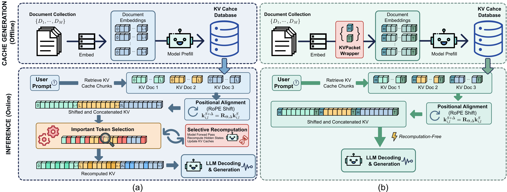

<h2 align="center">KV Packet: Recomputation-Free Context-Independent KV Caching for LLMs</h2>

<p align="center">
  Chuangtao Chen<sup>1</sup>,
  Grace Li Zhang<sup>2</sup>,
  Xunzhao Yin<sup>3</sup>,
  Cheng Zhuo<sup>3</sup>,
  Bing Li<sup>4</sup>,
  Ulf Schlichtmann<sup>1</sup><br>
  <sup>1</sup>Technical University of Munich,
  <sup>2</sup>Technical University of Darmstadt<br>
  <sup>3</sup>Zhejiang University,
  <sup>4</sup>Technische Universität Ilmenau
</p>

<p align="center">
  <a href="https://arxiv.org/abs/2604.13226"></a>
  &nbsp;&nbsp;&nbsp;
  <a href="https://pypi.org/project/kvpacket/"></a>
  &nbsp;&nbsp;&nbsp;
  <a href="LICENSE"></a>
</p>

> [!NOTE]
> 🎉 **KV Packet is now available on [PyPI](https://pypi.org/project/kvpacket/)
> with support for agentic flows.** Install it with `pip install kvpacket`, then
> explore the [repository-QA agent example](tasks/agentic_flow/repository_qa).

# KV Packet

Recomputation-free, context-independent KV caching for LLMs via trainable
soft-token **header/trailer** adapters. Independently precomputed document KV
caches are stitched together at serving time with only cheap RoPE realignment —
no token recomputation.

This repository is the reusable library implementation of
[*KV Packet: Recomputation-Free Context-Independent KV Caching for
LLMs*](https://arxiv.org/abs/2604.13226). It focuses on KV Packet
itself rather than competing research baselines, and also includes a controlled
evaluation track for **agentic / skill-based flows**.

> **Repository branches:** `main` contains the maintained KV Packet library. The
> [`paper-artifact`](https://github.com/ChuangtaoChen-TUM/KVPacket/tree/paper-artifact)
> branch preserves the original paper experiments, competing baselines,
> configurations, and result-processing scripts.

> **Status:** the core library, multi-document examples, and controlled agentic flow
> are implemented. See the [documentation](https://github.com/ChuangtaoChen-TUM/KVPacket/blob/main/docs/index.md)
> for architecture and environment guidance, and the
> [multi-document tasks](https://github.com/ChuangtaoChen-TUM/KVPacket/tree/main/tasks/multi_doc)
> for evaluation and adapter training.

## Method overview

<p align="center">
  
  <em><br>(a) Recomputation-based methods select and recompute cached tokens online.
  (b) KV Packet learns reusable header/trailer wrappers offline, enabling positional
  realignment and direct cache concatenation without document-token recomputation.</em>
</p>

## Installation

Install the library from PyPI:

```bash
pip install kvpacket
```

Install optional integrations as needed:

```bash
pip install "kvpacket[compress]"  # KVPress cache compression
pip install "kvpacket[serve]"     # OpenAI Responses-compatible HTTP/SSE transport
pip install "kvpacket[agent]"     # MCP support for agent examples
```

KV Packet requires Python 3.12 or newer. Install the PyTorch build appropriate for
your compute platform before loading a model.

### Development installation

When working from a clone of this repository, create the locked development
environment with `uv`:

```bash
uv sync
uv run python -c "import torch; print(torch.__version__, torch.cuda.is_available())"
```

Large-model experiments can optionally redirect environments, package caches, and
model weights to a user-chosen storage location. See
[the environment guide](https://github.com/ChuangtaoChen-TUM/KVPacket/blob/main/docs/getting-started.md)
for a portable example.

## Project structure

```text
KVPacket/
├── kvpacket/                 # Installable library
│   ├── backend/              # Compute protocols and Hugging Face backend
│   ├── packet/               # Sources, wrappers, encoding, and registry
│   ├── kvcache/              # Cache tensors, positions, and RoPE operations
│   ├── runtime/              # Reentrant matching and packet-aware execution
│   ├── session/              # Stateful recording, serving, and packet storage
│   ├── training/             # Wrapper initialization and distillation
│   ├── compression/          # Optional KVPress integration
│   ├── serve/                # Optional codecs, adapters, state, and HTTP/SSE
│   └── preprocessing.py      # Offline source-to-packet construction
├── tasks/
│   ├── multi_doc/            # Record, train, and evaluate multi-document tasks
│   └── agentic_flow/         # Controlled agent and skill-flow examples
├── examples/                  # Focused serving integration examples
├── docs/                      # Concepts, guides, and API reference
├── tests/                     # Unit, integration, and reference-parity tests
└── pyproject.toml             # Package metadata and dependency groups
```

Start with the [documentation index](docs/index.md) for setup, guides, and API
reference, or read the [architecture overview](docs/concepts/architecture.md) for
layer ownership and the offline, online, and training execution paths.

The layers above `PacketExecutor` are optional: applications with an existing request
adapter, model renderer, or session manager can integrate directly with the reentrant
runtime. `PacketPreprocessor` and `PacketTrainer` construct the wrappers and packet
stores consumed by that online core.

## Backend selection

Inference sessions require an explicit compute backend. The Hugging Face backend owns
Hugging Face model capability checks; the session engine stays backend-agnostic.

```python
from kvpacket import HFBackend, PacketSession

backend = HFBackend(model)
session = PacketSession(backend=backend, tokenizer=tokenizer)
```

Source preprocessing is separate from the compute backend. Use `TextSourceEncoder` for
`RawText` and local text files, or provide another framework-side `SourceEncoder` for a
different modality.

`backend.forward(...)` performs one independent or cache-extending model call;
`PacketSession` orchestrates repeated incremental calls and generation.
`backend.prefill_caches(...)` is the offline batched operation used to construct
independent packet caches while removing padding.

## Serving preprocessed packets

Wrapper selection happens only during offline preprocessing. Serving registers the
stored match representations and keeps `push()` / `generate()` wrapper-agnostic:

```python
store = PacketStore.load("agent-packets.pt", backend=backend)
session = PacketSession(backend=backend, store=store, tokenizer=tokenizer)
session.register_store_chunks()
session.push(prompt_containing_registered_content)
result = session.generate()
```

Registration verifies that the session tokenizer reproduces the preprocessed
tokens. It never rebuilds packets or reloads wrapper tensors.

## Integrating an existing serving stack

`PacketExecutor` exposes the packet-aware forward path without owning conversation
state. Existing inference servers can retain their current cache/session manager and
pass a `PacketCacheState` into each operation. Optional higher layers provide a
model-specific `ModelCodec`, bounded `PacketStateManager`, and pure OpenAI Responses
and Anthropic Messages adapters.

```python
from kvpacket import PacketCacheState, PacketExecutor

executor = PacketExecutor(backend=backend, store=store)
result = executor.prefill(PacketCacheState(), rendered_input_ids)
caller_owned_state = result.cache_state
first_token_logits = result.first_token_logits
```

See the [serving guide](https://github.com/ChuangtaoChen-TUM/KVPacket/blob/main/docs/guides/serving.md)
for the layer contracts and the
[serving example](https://github.com/ChuangtaoChen-TUM/KVPacket/blob/main/examples/serve_requests.py)
for direct integration.

### OpenAI Responses HTTP/SSE endpoint

The optional Starlette transport lets OpenAI SDK clients and Codex-style agent
frameworks route self-contained Responses requests through the same completion engine:

```bash
uv sync --extra serve
uv run python -m examples.run_responses_server \
  --model Qwen/Qwen3-8B \
  --packet-store checkpoints/agent-packets.pt \
  --model-alias qwen3-8b-kvpacket
```

It exposes `POST /v1/responses`, `GET /v1/models`, and `GET /healthz`. Streaming is
live: text deltas are sent as tokens become safe to expose, followed by function or
free-form tool-call events and a terminal Responses event. The endpoint retains the
preprocessed packet catalog but no request history; callers send the complete visible
conversation on each turn. Binding defaults to `127.0.0.1`, and bearer auth, request
limits, token limits, and model concurrency are configurable. See
[Responses server example](https://github.com/ChuangtaoChen-TUM/KVPacket/blob/main/examples/run_responses_server.py)
and the HTTP section of the
[serving guide](https://github.com/ChuangtaoChen-TUM/KVPacket/blob/main/docs/guides/serving.md).

## Optional offline cache compression

Install `kvpacket[compress]` and pass a `KVPressCompressor` during preprocessing:

```python
from kvpacket import KVPressCompressor, PacketPreprocessor

preprocessor = PacketPreprocessor(
    backend=backend,
    wrapper_registry=wrapper_registry,
    source_encoder=source_encoder,
    cache_compressor=KVPressCompressor("knorm", compression_ratio=0.5),
)
```

Compression shortens the physical KV tensors while preserving the original logical
wrapped-source span for position IDs. Method, version, ratio, options, and both lengths
are covered by packet identity and persistence. See
the [compression guide](https://github.com/ChuangtaoChen-TUM/KVPacket/blob/main/docs/guides/compression.md)
for supported presses and limitations.

## Training recorded samples

`PacketSession` RECORD output is dataset-independent. A trainer reconstructs marked
spans using source-to-wrapper routing supplied to `PacketTrainer`, so documents,
skills, and tool descriptions can use different wrappers in one trajectory:

```python
from kvpacket import PacketTrainer

trainer = PacketTrainer(
    backend,
    wrapper_registry,
    wrapper_assignments={"doc-0": "biography_doc", "skill-0": "powerpoint_skill"},
    optimize=["biography_doc", "powerpoint_skill"],  # or "all" / "none"
    objective="teacher_kl",  # or "teacher_ce" for compact token-only teachers
    loss_reduction="token_mean",  # or "sample_mean"
    optimizer_kwargs={"lr": 1e-3},
)
metrics = trainer.fit(
    recorded_samples,
    epochs=3,
    target_tokens_per_step=2048,
    batch_size=64,          # maximum samples for token-budget batching
    forward_batch_size=4,  # optional padded 4-D model forwards
)
trainer.save("checkpoints/agent-trainer.pt")
```

The Hugging Face backend freezes the base model and owns the differentiable model
call. Only selected header/trailer tensors are optimized. The atomic trainer
checkpoint contains the full wrapper registry, per-wrapper optimizer states, and
training provenance; restore it with `PacketTrainer.load(path, backend=backend)`.
For fixed sample-count training, select `loss_reduction="sample_mean"` and omit
`target_tokens_per_step`. See the
[training guide](https://github.com/ChuangtaoChen-TUM/KVPacket/blob/main/docs/guides/training.md).

A complete, intentionally small RECORD → train → evaluate example is available at
[multi-document training example](https://github.com/ChuangtaoChen-TUM/KVPacket/blob/main/tasks/multi_doc/train.py).
It uses the synthetic
multi-document fixture and a compact token-ID teacher by default:

```bash
CUDA_VISIBLE_DEVICES=0 uv run python tasks/multi_doc/train.py \
  --config tasks/multi_doc/training_configs/synthetic_qwen.json
```

For a minimal Codex agent integration, see
[repository-QA agent example](https://github.com/ChuangtaoChen-TUM/KVPacket/tree/main/tasks/agentic_flow/repository_qa).
It includes
a short local prompt list, bounded read-only tools, compact Full Recompute sample
recording, wrapper training, packet materialization, serving through the
Responses-compatible endpoint, and an optional read-only MCP server for Codex. The flow
follows Codex progressive disclosure: skill metadata is initially resident, while only
the conditionally loaded skill body is packetized. A small trained Qwen3-4B wrapper is
included; experiment datasets, trajectories, and benchmark baselines are not.

## Citation

If you use KV Packet in your work, please cite:

```bibtex
@misc{chen2026kvpacket,
  title         = {KV Packet: Recomputation-Free Context-Independent KV Caching for LLMs},
  author        = {Chuangtao Chen and Grace Li Zhang and Xunzhao Yin and Cheng Zhuo and Bing Li and Ulf Schlichtmann},
  year          = {2026},
  eprint        = {2604.13226},
  archivePrefix = {arXiv},
  primaryClass  = {cs.LG},
  url           = {https://arxiv.org/abs/2604.13226},
}
```
